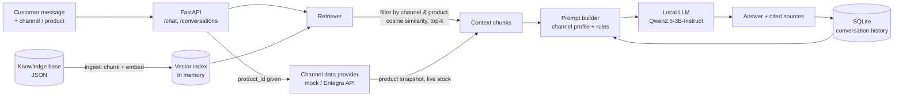

# E-Commerce Support Chatbot (RAG)

A customer-support chatbot for an online store that answers questions about products, shipping, returns and
payments in Turkish. It uses **retrieval-augmented generation (RAG)**: relevant passages are first retrieved from the
store's knowledge base with semantic search, then a **locally hosted open-source LLM** writes the answer using only
that context.

> **Status:** working prototype, tested locally with the sample knowledge base in `app/data/`. See
> [Limitations & next steps](#limitations--next-steps).

## Highlights

- **Semantic search over the knowledge base**: documents are chunked with overlap and embedded with a multilingual
  Sentence-Transformers model; questions are matched by cosine similarity (top-k with a minimum relevance score).
- **Local LLM, no external API**: `Qwen/Qwen2.5-3B-Instruct` runs through Hugging Face Transformers (FP16 on GPU),
  so customer messages never leave the server and there is no per-request cost.
- **Grounded answers**: the system prompt restricts the model to the retrieved context; when the context is not
  enough, it asks the customer a clarifying question instead of inventing an answer.
- **Sales-channel awareness**: the same product can have different shipping and return rules on the website,
  Trendyol, Hepsiburada and Amazon. Retrieval is filtered by channel and product, and each channel has its own answer
  style (tone, length, formatting).
- **Conversation memory**: conversations and messages are stored in SQLite; the last N messages are sent to the model
  as history.
- **Live product data (optional)**: an integration with the Entegra marketplace-management API (JWT auth,
  paginated product sync, stock cache) can feed the catalogue into the index and answer stock questions with live
  numbers.
- **REST API + test UI** built with FastAPI.

## Architecture



### Request flow

1. The API receives the message together with the sales channel and, optionally, a product ID.
2. The **retriever** keeps only documents for that channel/product, scores them by cosine similarity between the
   question embedding and each chunk embedding, and returns the top-k chunks above `RAG_MIN_SCORE`.
   If `sentence-transformers` is not installed it falls back to keyword overlap.
3. If a product ID is given, the **channel data provider** adds a product snapshot; if the question is about stock,
   it also adds the live stock count.
4. The **prompt builder** combines the channel profile, the answer rules, the retrieved context and the recent
   conversation history.
5. The **LLM** generates the answer with greedy decoding. The response also lists the sources used, with their scores.

## Tech stack

| Area | Tools |
|---|---|
| API | FastAPI, Uvicorn, Pydantic |
| LLM | Hugging Face Transformers, PyTorch, `Qwen/Qwen2.5-3B-Instruct` |
| Embeddings | Sentence-Transformers, `paraphrase-multilingual-MiniLM-L12-v2` |
| Storage | SQLite (conversations), JSON (knowledge base and index) |
| Integration | Entegra REST API via `requests` |
| Tests | pytest |

## Getting started

Requirements: Python 3.10+. A CUDA GPU is recommended (the 3B model needs roughly 6–7 GB of VRAM in FP16);
on CPU set `DEVICE=cpu` and expect slow answers.

```bash
python -m venv .venv
.venv\Scripts\activate          # Windows  (macOS/Linux: source .venv/bin/activate)
pip install -r requirements.txt

copy .env.example .env          # macOS/Linux: cp .env.example .env

# Build the search index from the knowledge base
python -m app.rag.ingest --input app/data/knowledge_base.json --output app/data/rag_index.json

# Start the API (the model is downloaded from Hugging Face on first run)
uvicorn app.main:app --reload
```

Then open <http://127.0.0.1:8000/ui> for the test chat UI, or <http://127.0.0.1:8000/docs> for the interactive API docs.

### Example request

```bash
curl -X POST http://127.0.0.1:8000/chat \
  -H "Content-Type: application/json" \
  -d '{"message": "Bu urun kac gunde kargoya verilir?", "channel": "trendyol", "product_id": "1001"}'
```

The response contains the answer, the sources that were used (`doc_id`, `title`, `score`), the channel profile and,
for stock questions, the live stock value.

## API

| Method | Path | Description |
|---|---|---|
| `GET` | `/` | Health check and active configuration |
| `GET` | `/ui` | Browser test UI |
| `POST` | `/chat` | Single question, no history |
| `GET` / `POST` | `/conversations` | List / create conversations |
| `GET` | `/conversations/{id}` | Conversation with its messages |
| `POST` | `/conversations/{id}/messages` | Send a message inside a conversation (uses history) |
| `POST` | `/sync/entegra` | Pull products from Entegra, rebuild the index and reload the retriever |

## Configuration

All settings are read from `.env` (see `.env.example`).

| Variable | Default | Meaning |
|---|---|---|
| `MODEL_ID` | `Qwen/Qwen2.5-3B-Instruct` | Hugging Face model used for generation |
| `DEVICE` | `cuda` | `cuda` or `cpu` |
| `MAX_NEW_TOKENS` | `256` | Maximum answer length |
| `CHAT_HISTORY_LIMIT` | `8` | Messages of history sent to the model |
| `RAG_TOP_K` | `4` | Number of chunks retrieved |
| `RAG_MIN_SCORE` | `0.15` | Chunks below this similarity are ignored |
| `RAG_EMBEDDING_MODEL` | `paraphrase-multilingual-MiniLM-L12-v2` | Embedding model |
| `CHANNEL_DATA_PROVIDER` | `mock` | `mock` (knowledge base) or `entegra` (live API) |
| `ENTEGRA_*` | disabled | Entegra API URL, endpoints and credentials |

## Project structure

```
app/
  main.py               FastAPI app and chat pipeline
  config.py             Settings from .env
  llm.py                Local LLM wrapper (Transformers)
  channels.py           Per-channel answer profiles
  rag/
    ingest.py           Chunking + index builder (CLI)
    retriever.py        Embedding search, metadata filters, keyword fallback
    prompt_builder.py   Grounded system/user prompts
  providers/            Product data: mock provider and Entegra provider
  integrations/
    entegra.py          Entegra API client: auth, paginated product sync, stock cache
  storage/
    conversation_store.py   SQLite conversations and messages
  ui/test_ui.py         Minimal HTML chat UI
  data/                 Sample knowledge base and index
tests/                  pytest suite (chunking, retrieval, prompts, storage)
```

## Tests

```bash
pip install pytest
pytest
```

The tests cover chunking, retrieval ranking and filters (including cosine ranking with a stub embedder), prompt
construction and the SQLite store. They do not need a GPU or model downloads.

## Design decisions

- **Multilingual MiniLM embeddings**: supports Turkish and is small and fast enough to run next to the LLM.
- **Local model instead of a hosted API**: keeps customer data on the server and makes costs predictable.
- **Minimum score + "ask instead of guessing" rule**: reduces hallucinated answers when nothing relevant is found.
- **Metadata filters before similarity search**: prevents, for example, Amazon return rules from being used to answer
  a Trendyol customer.

## Limitations & next steps

- Embeddings are kept **in memory** and recomputed at startup. The next step is a persistent vector store
  (pgvector, FAISS or Chroma) so large catalogues do not need re-embedding.
- The Entegra integration is implemented but disabled by default; it needs real API credentials to run.
- There is no evaluation set yet. Planned: a small question set to measure retrieval hit rate and answer
  groundedness, then hybrid search (BM25 + vectors) and re-ranking.
- Answers are returned in one piece; streaming and a Docker setup are planned.
